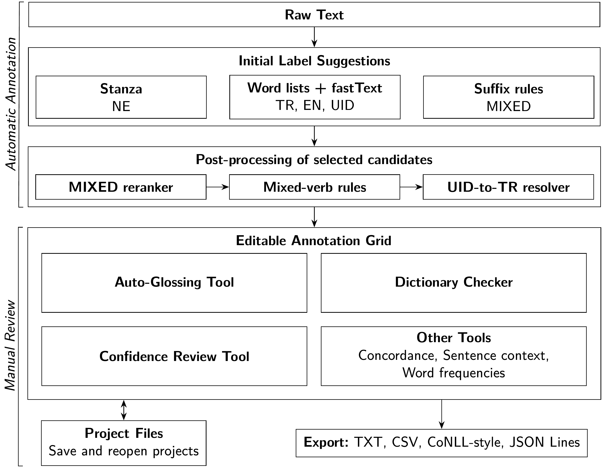

# Summary

TREN is an open-source desktop application designed to streamline the semi-automatic annotation, inspection, and morphological analysis of mixed-language text data. It combines token-level language identification, intra-word code-switching detection, and editable morphological glossing for Turkish–English code-switching in a graphical interface for researchers without programming expertise.

Code-switching (CS) refers to the use of two or more languages in alternation within a conversation by bilingual speakers [@milroy1995]. Its study offers insights into the grammatical interaction between languages [@poplack1980; @sankoff1981; @disciullo1986; @myersscotton1993; @macswan1999]. It also contributes to understanding how language alternation carries social meanings and serves communicative functions [@blom1972; @gumperz1982; @milroy1995; @bhatt2011], and how mixed linguistic forms are represented and processed [@valdeskroff2018; @stefanich2019]. Corpus-based analysis of these patterns requires annotated data for identifying and comparing language choices across speakers and communicative contexts.

Token-level language labels provide a starting point for organizing such data for analysis. Yet, assigning them raises several challenges. CS can occur between sentences (inter-sentential CS), within a sentence (intra-sentential CS) [@poplack1980; @milroy1995, p. 8], and within a single word (intra-word CS) [@stefanich2019; @mager2019]. Some forms also occur in both languages, making context necessary for determining their language label. Within these, intra-word CS presents an additional annotation challenge. For example, *meeting'e* (‘to the meeting’) combines an English stem *meeting* with a Turkish dative suffix *-e*. Assigning a MIXED label to this token identifies involvement of both languages but does not distinguish the stem from the suffix or indicate the suffix’s grammatical function. Capturing these details requires further morphological annotation.

TREN is developed to address these current challenges. Researchers load raw text, and TREN proposes a label for each token. Because every token is labeled, all three types of CS can be examined in the same environment. Researchers review and correct these suggestions in a spreadsheet grid, supported by concordance and word-frequency views for examining word usage. For tokens labeled MIXED, a separate glossing tool then suggests an editable morphological gloss that separates the stem from its suffixes. Researchers can also check words and proposed roots in the Turkish Language Association’s online dictionary [@tdk_sozluk] to help distinguish established borrowings from CS. Projects can be saved and reopened across sessions, and annotated data can be exported for further analysis or sharing outside TREN.

# Statement of need

In code-switching (CS) research, preparing a dataset of bilingual text requires more than assigning language labels. Forms shared by both languages may require context to determine their language label [@nguyen2021; @dogan2026]. These decisions should be made consistently across the corpus under human review. Intra-word CS forms challenge language-identification approaches that assume one language per token [@mager2019], because they combine elements from different languages within a single word [@stefanich2019]. The TurEngMix benchmark by Dogan et al. [-@dogan2026] shows that state-of-the-art decoder LLMs and fine-tuned encoders still struggle with Turkish–English intra-word switches. Across their experiments, models achieved substantially lower F1 scores for mixed-language tokens than for monolingual Turkish and English tokens. Their error analysis showed that GPT-4o and Qwen3-8B frequently misclassified English stems bearing Turkish suffixes as Turkish [@dogan2026]. While their work provides an essential static benchmark, compiling and exploring new datasets still requires an interactive environment where researchers can inspect subword boundaries and verify suggestions in context.

Existing studies describe the wider difficulties of processing code-switched data [@cetinoglu2016]. Some propose subword-level language identification and the detection of intra-word switches [@mager2019; @nguyen2016], and others offer semi-automatic annotation methods [@nguyen2021] and annotated resources [@cetinoglu2023]. A researcher compiling a new Turkish–English corpus must still turn such methods into a reviewed, labeled, and glossed dataset, checking each suggestion in context.

TREN responds to this practical need for Turkish–English data by combining automatic label suggestions, editable labels, a separate glossing tool for mixed words, and researcher oversight in a ready-made desktop environment. It is intended to make corpus preparation easier and to reduce repetitive work, leaving analytic decisions to the researcher.

# State of the field

Several studies address the annotation of code-switched data. Sabty et al. [-@sabty2021] present a web-based application in which annotators label words and split mixed words into parts. They describe the application as usable for any language pair. The Bangor Autoglosser [@donnelly2011] glosses bilingual corpora from transcriptions already tagged for language, using dictionaries for Welsh, Spanish, and English. Nguyen et al. [-@nguyen2021] label tokens semi-automatically with word lists and rules, extending an approach first developed for Vietnamese–English speech transcriptions to Hindi–English social media text. Yirmibeşoğlu and Eryiğit [-@yirmibesoglu2018] approach code-switching detection as word-level language identification, labeling each word as Turkish or English. While recent works like TurEngMix [@dogan2026] provide an annotated benchmark for evaluating model performance, they do not offer an interactive, end-user desktop workflow for corpus compilation and morphological glossing.

These studies address different aspects of annotation. However, preparing data for TREN-supported analyses involves reviewing token-level language suggestions, identifying English stems with Turkish suffixes, adding morphological glosses, and correcting annotations in context. None of the workflows combines all these tasks for Turkish–English data. Furthermore, the dictionaries and word lists described by Donnelly and Deuchar [-@donnelly2011] and Nguyen et al. [-@nguyen2021] do not include Turkish.

To date, no existing desktop tool offers ready-made language labeling, intra-word code-switching detection, and morphological glossing for Turkish–English data in a single workflow. TREN combines these functions with dictionary checks and corpus tools in an interface designed for researchers without programming expertise.

# Software design

TREN is a Python desktop application with a Tkinter interface [@tkinter]. The annotation pipeline operates independently of the interface, allowing it to be run and tested separately. TREN processes each non-empty input line as a separate block. It identifies tokens within each line, preserving internal apostrophes, URLs, and numbers while removing standalone punctuation other than apostrophes. \autoref{fig:workflow} summarizes the annotation workflow.

{width="90%"}

The annotation scheme includes Turkish (TR), English (EN), mixed-language (MIXED), named entity (NE), unidentified (UID), and non-lexical items (OTHER). Researchers can also assign LANG3 to indicate another language. Non-lexical tokens receive the OTHER label. When named-entity recognition is enabled, Stanza identifies entities in each input line [@qi2020]. Remaining tokens are checked against Turkish and English frequency word lists from FrequencyWords [@frequencywords]. If these do not provide a decision, fastText is used for language identification [@joulin2017]. Unresolved tokens receive the UID label. After token labeling, rule-based suffix analysis checks eligible tokens for combinations of an English stem and Turkish suffixes. It handles forms both with and without an apostrophe. English stems are identified through word-list membership or fastText predictions, while suffix rules recognize selected Turkish inflectional and derivational forms. Tokens meeting these conditions are labeled MIXED. The word lists and suffix rules provide explicit linguistic evidence that can be presented during review. The workflow could also serve as an adaptable architecture for other language pairs, particularly those involving agglutinative morphology, although adaptation requires language-specific word lists, suffix rules, and dictionary resources.

Then, post-processing begins with a pre-trained logistic-regression classifier referred to as the reranker. The reranker was trained on labeled data from the corpus prepared using TREN [@bostan2026corpus]. Thus, users need not train a model. Candidates include UID tokens, NE tokens with a plausible Turkish suffix analysis, and TR tokens with evidence of an English stem and Turkish suffixes. The classifier considers character sequences, word-list membership, fastText predictions, and possible stem–suffix analyses. Candidates are relabeled MIXED if the estimated probability reaches a predefined threshold. The reranker makes no other label changes. Then, a separate rule-based check identifies selected mixed verb forms among tokens still labeled UID or TR. It looks for English word-list stems followed by specific Turkish verbalizing suffixes and supported combinations of further endings. It checks for competing analyses that restrict which forms receive the MIXED label. The UID-to-TR resolver then examines remaining unidentified tokens. It combines Turkish word-list matches, valid suffix sequences, fastText predictions, and Turkish-specific letters. Relabeling requires at least two types of supporting evidence and a combined score at or above a predefined threshold. Tokens with insufficient evidence remain UID.

After automatic labeling, researchers review and correct labels in an editable grid. Matrix and Embedded language fields use terminology from the Matrix Language Frame model [@myersscotton1993] for summarizing weighted token-label counts for both languages. Concordance and Sentence-Context View tools provide access to the input text, while the Frequency List tool gives frequency summaries. The Confidence Review tool presents uncertain labels alongside supporting evidence, including reranker predictions where available. It supports manual review without automatically changing labels. Its rule-based confidence scores summarize the evidence supporting each label.

Researchers can initiate morphological glossing separately for tokens labeled MIXED using the Auto-Glossing Tool. Separating language labeling from morphological glossing lets researchers review language assignments before requesting morphological suggestions. This adds a separate user action but gives researchers control over when morphological detail is introduced. It suggests editable Leipzig-style glosses [@comrie2008] from a predefined inventory of selected Turkish inflectional and derivational suffixes. The TDK Checker tool also lets users check words, proposed roots, and segments against the Turkish Language Association’s dictionary [@tdk_sozluk]. The results provide additional evidence without changing labels or glosses.

The desktop design keeps corpus processing on the researcher’s computer and supports offline annotation once the required models are available locally. Missing named-entity models are downloaded with the user’s approval when this feature is enabled. Optional dictionary checks require an internet connection and transmit only the queried term. Project files preserve work across sessions, and annotations can be exported as TXT, CSV, CoNLL-style, or JSON Lines files.

# Research impact statement

TREN was first developed to examine examples of intra-word code-switching. Then, it was further developed as part of the author’s TÜBİTAK 2209-A research project on the sociolinguistic and pragmatic patterns of Turkish–English intra-word code-switching, and its scope widened as that work advanced. The application became an environment in which the researcher can label and correct data and examine words in context, with annotation and corpus tools in one place for different types of code-switching.

Version 1.0.0 of TREN, released in February 2026, was used to annotate the Turkish–English Intra-Word Code-Switching Corpus. The corpus was the first openly available corpus to combine token-level language labels, explicit MIXED annotations, and Leipzig-style morphological glosses specifically for Turkish–English intra-word code-switching [@bostan2026corpus]. The corpus is licensed under CC BY 4.0 and contains 201 text blocks from public Reddit posts, comprising 3,132 tokens, 236 of which are labeled MIXED. In the project, corpus examples were used in interviews and surveys, linking the annotation carried out in TREN to data collected from research participants.

# AI usage disclosure

Generative AI tools were used during the development of this application to assist with problem solving, coding and code refactoring. All generated content was reviewed, tested, and validated by the author. No generative AI tools were used in the writing of this manuscript or supporting corpus data.

# Acknowledgements

TREN’s development has been supervised by Dr. Emre Yağlı from Hacettepe University. The research project in which TREN was developed is funded by the Scientific and Technological Research Council of Turkey under project number 1919B012557617. The project itself received ethical approval from the Hacettepe University Social Sciences and Humanities Research Ethics Board on December 23, 2025 (meeting no. 2025/24).

# References
